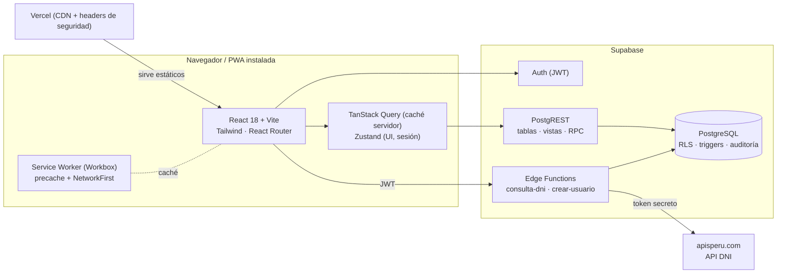

# Arquitectura técnica

## 1. Visión general



**Principios**

| Principio | Cómo se aplica |
|---|---|
| Seguridad en la base de datos | Toda autorización real vive en RLS + triggers. El frontend solo oculta botones (`src/lib/permissions.ts`). |
| Reglas de negocio en el servidor | Cupos, duplicados, saldo máximo y snapshot de precio se validan con triggers; el cliente valida con Zod solo para UX. |
| Secretos fuera del cliente | Token DNI y `service_role` solo en Edge Functions (`supabase secrets`). El navegador solo conoce la `anon key`. |
| Datos derivados en vistas | `v_inscripciones_detalle` calcula total, pagado, saldo y estado de pago; nunca se guarda un saldo que pueda desincronizarse. |
| Soft delete + auditoría | Nadie puede borrar físicamente (no hay políticas DELETE). `deleted_at` + trigger de auditoría para INSERT/UPDATE/DELETE. |
| Code splitting | Cada página se carga con `lazy()`; Excel/PDF se importan solo al exportar. |

## 2. Capas del frontend

```
src/
├── api/          Acceso a Supabase por entidad (cursos.api.ts, pagos.api.ts…). Única capa que llama a supabase.from()
├── services/     Integraciones: API DNI, exportación Excel/PDF, notificaciones SweetAlert2
├── hooks/        Hooks de TanStack Query (useCursos, usePagos…) + utilitarios (useDebounce, useOnline, usePwaInstall)
├── store/        Zustand: ui.store (tema, sidebar) y auth.store (sesión, perfil, rol)
├── contexts/     AuthProvider (ciclo de sesión) y ThemeProvider
├── schemas/      Esquemas Zod compartidos por formularios
├── components/   ui/ (design system), charts/ (Recharts), forms/, layout/, reportes/
├── layouts/      AppLayout (sidebar colapsable + topbar) y AuthLayout
├── pages/        Una carpeta por módulo
├── routes/       Router y guards (RequireAuth, RequirePermiso)
├── lib/          Cliente Supabase, QueryClient, constantes, permisos, tema de gráficos
├── types/        Tipos del dominio
└── utils/        Formato Perú (es-PE, PEN, America/Lima), errores, fechas
```

Flujo típico (registrar pago): `PagoFormModal` → `useRegistrarPago()` → `pagosApi.registrar()` → `POST /rest/v1/pagos` → RLS verifica rol → trigger `fn_validar_pago` verifica saldo → trigger de auditoría → la mutación invalida `pagos`, `inscripciones`, `cursos`, `dashboard` y `reportes`.

## 3. Modelo entidad-relación

```mermaid
erDiagram
  ROLES ||--o{ USUARIOS : asigna
  USUARIOS ||--o{ CURSOS : "crea (created_by)"
  USUARIOS ||--o{ AUDITORIA : registra
  CURSOS ||--o{ INSCRIPCIONES : tiene
  ESTUDIANTES ||--o{ INSCRIPCIONES : realiza
  INSCRIPCIONES ||--o{ PAGOS : recibe

  ROLES { smallint id PK; text codigo UK; text nombre; text descripcion }
  USUARIOS { uuid id PK "= auth.users.id"; text email UK; text nombre_completo; smallint rol_id FK; bool activo; timestamptz created_at; timestamptz updated_at; timestamptz deleted_at }
  CURSOS { uuid id PK; varchar codigo "UK si no eliminado"; varchar nombre; text descripcion; date fecha_inicio; date fecha_fin; varchar horario; enum modalidad; numeric costo; int cupos; enum estado; timestamptz created_at; timestamptz deleted_at }
  ESTUDIANTES { uuid id PK; char dni "UK si no eliminado"; varchar nombres; varchar apellido_paterno; varchar apellido_materno; varchar correo; varchar telefono; varchar direccion; date fecha_nacimiento; enum estado; timestamptz created_at; timestamptz deleted_at }
  INSCRIPCIONES { uuid id PK; uuid estudiante_id FK; uuid curso_id FK; date fecha_inscripcion; enum estado; text observacion; numeric monto_total "snapshot del costo"; timestamptz deleted_at }
  PAGOS { uuid id PK; uuid inscripcion_id FK; numeric monto; date fecha_pago; enum medio_pago; varchar numero_operacion; text observaciones; timestamptz deleted_at }
  AUDITORIA { bigint id PK; uuid usuario_id; text usuario_email; enum accion; text tabla; text registro_id; jsonb datos_anteriores; jsonb datos_nuevos; timestamptz fecha }
```

**Enumerados:** modalidad (`presencial`, `virtual`, `hibrido`) · estado de curso (`programado`, `en_ejecucion`, `finalizado`, `cancelado`) · estado de inscripción (`preinscrito`, `inscrito`, `retirado`, `finalizado`) · medio de pago (`efectivo`, `yape`, `plin`, `transferencia`, `tarjeta`) · estado de pago calculado (`pendiente`, `parcial`, `pagado`).

### Objetos de base de datos

| Tipo | Nombre | Propósito |
|---|---|---|
| Vista | `v_inscripciones_detalle` | Inscripción + estudiante + curso + total pagado + **saldo pendiente** + estado de pago |
| Vista | `v_pagos_detalle` | Pagos con nombres de estudiante, curso y usuario que registró |
| Vista | `v_cursos_resumen` | Curso + inscritos, cupos disponibles, pagados, pendientes, recaudado, por cobrar |
| RPC | `fn_dashboard_resumen()` | Tarjetas del dashboard en una sola llamada |
| RPC | `fn_recaudacion_mensual(desde, hasta)` | Serie mensual para gráficos |
| Trigger | `fn_validar_inscripcion` | Curso abierto, estudiante activo, **no duplicado**, **cupos disponibles**, snapshot de costo |
| Trigger | `fn_validar_pago` | **Monto ≤ saldo**, inscripción no retirada |
| Trigger | `fn_confirmar_inscripcion_pagada` | Preinscrito → inscrito al primer pago |
| Trigger | `fn_auditoria` | INSERT / UPDATE / DELETE (soft delete se registra como DELETE) |
| pg_cron | `purgar-auditoria` → `fn_purgar_auditoria(12)` | Día 1 de cada mes, 03:00 Lima: borra auditoría con más de 12 meses |
| Trigger | `fn_nuevo_usuario_auth` | Crea el perfil al registrarse en Auth (el primer usuario es administrador) |
| Trigger | `fn_proteger_usuarios` | Nadie cambia su propio rol/estado; no-admins solo cambian su nombre |

Todas las vistas usan `security_invoker = true`, por lo que respetan el RLS del usuario.

### Cálculo del saldo

```
Total del curso        = inscripciones.monto_total   (copiado de cursos.costo al inscribir)
(−) Pagos registrados  = SUM(pagos.monto) WHERE deleted_at IS NULL
-------------------------------------------------
Saldo pendiente        = total − pagado
Estado de pago         = pagado si saldo ≤ 0 · parcial si pagado > 0 · pendiente en otro caso
```

## 4. Estado y caché

* **TanStack Query** guarda respuestas por clave (`['cursos','lista',filtros]`). `staleTime` 30 s, `networkMode: 'offlineFirst'` para mostrar datos en caché sin conexión. Cada mutación invalida las claves afectadas.
* **Zustand** mantiene preferencias de UI persistidas (`gc-ui` en localStorage) y la sesión/rol en memoria.
* **Paginación del lado servidor** con `range()` y `count: 'exact'`; búsqueda con debounce de 300 ms e índices trigram (`pg_trgm`).

## 5. PWA

* `vite-plugin-pwa` (Workbox `generateSW`), manifest en `vite.config.ts`, íconos en `public/icons` (incluye `maskable` para Android y `apple-touch-icon` para iPhone).
* **Precache** del shell de la app; las librerías de exportación se cachean al primer uso.
* **Runtime caching**: `NetworkFirst` (6 s) para lecturas REST de Supabase → modo offline de solo lectura; `StaleWhileRevalidate` para fuentes.
* `registerType: 'prompt'`: el componente `UpdatePrompt` avisa cuando hay versión nueva. `InstallBanner` usa `beforeinstallprompt` en Android y muestra instrucciones en iOS (Safari no expone ese evento).
* Banner amarillo "Sin conexión" en `AppLayout`. Las escrituras requieren red (mutaciones con `networkMode: 'online'`) para no generar conflictos de cupos/saldos.

## 6. Escalabilidad

* Índices parciales (`WHERE deleted_at IS NULL`) en todas las búsquedas y FKs.
* Los reportes agregan en el cliente sobre resultados filtrados (hasta ~20 000 filas). Para volúmenes mayores, mover agregaciones a funciones RPC como `fn_recaudacion_mensual` o a vistas materializadas refrescadas con `pg_cron`.
* Separar lectura pesada: los reportes pueden apuntar a una réplica de lectura de Supabase sin cambiar el código (otra URL de cliente).
* La capa `api/` aísla Supabase: cambiar de backend solo toca esa carpeta.
